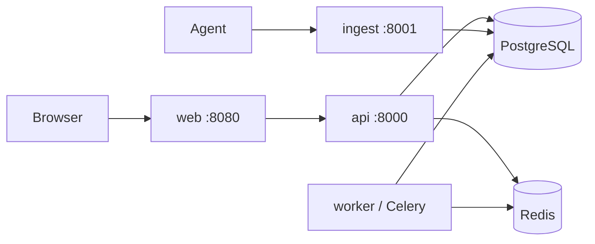

# SAMoparser — командный каркас

Репозиторий предназначен как стартовая площадка для команды, а не как готовая SAM-система. Здесь есть запускаемый контейнерный каркас сервисов, локальная инфраструктура, Helm-шаблон и CI/CD; доменная логика SAM, миграции и функции ИИ реализуются по плану работ.

## Архитектура



- `services/backend` — общий Python-образ и минимальные точки входа `app.api`, `app.ingest`, `app.worker`.
- `services/web` — интерфейс React/Vite и обратный прокси nginx.
- `services/agent` — пример отправителя, который команда заменит полноценным сборщиком для Windows/Linux.
- `deploy/helm/sam` — общий Helm-чарт с отдельными Deployment для API, загрузчика, обработчика и web-интерфейса.
- PostgreSQL и Redis в Kubernetes предполагаются внешними. PostgreSQL в локальном Compose — `pgvector/pgvector:pg16`.

Детальная архитектура: [`docs/architecture.md`](docs/architecture.md). Поэтапный backlog: [`docs/implementation-plan.md`](docs/implementation-plan.md).

## Допущения

1. Для MVP выбран общий backend package/image с разными entrypoints: это снижает дублирование, но не является окончательной границей микросервисов.
2. Redis используется как Celery broker/cache; источник истины — внешний PostgreSQL.
3. Helm не создаёт PostgreSQL, Redis или Secret. Они создаются платформенной командой заранее.
4. В production migration hook выключен (`migrations.enabled=false`), а локально миграция выполняется отдельным контейнером `migrate`.
5. Для векторов целевой основной путь — pgvector; fallback `float8[]/jsonb` и cosine similarity должен быть отдельной задачей этапа 6.
6. OpenAI API, JWT, авторизация по API-ключу и расширенная аналитика реализуются по плану. Минимальные CRUD, сопоставление, расчёт лицензий и панель управления уже добавлены в тестовый прототип.
7. Указанные образы и `sam.example.com` — placeholders; registry и домен задаются через CI variables/Helm values.

## Локальный запуск

```bash
./scripts/dev.sh env
./scripts/dev.sh up
curl http://localhost:8000/health
curl http://localhost:8001/ready
open http://localhost:8080
```

Полезные команды:

```bash
./scripts/dev.sh status
./scripts/dev.sh logs api worker
./scripts/dev.sh config
./scripts/dev.sh restart
./scripts/dev.sh down

# Альтернативно через Makefile
make up
make down
make logs
make build
make test
make lint
make helm-lint
```

`./scripts/dev.sh env` не перезаписывает существующий `.env`. Для явной ротации локальных секретов используйте `./scripts/dev.sh env --force`. Скрипт устанавливает права файла `0600` и использует `openssl rand` либо `python3 secrets`.

`make migrate` запускает Alembic-миграции в контейнере. `make seed` пока оставлен точкой расширения.

## Секреты Kubernetes

Создать Secret вне Git:

```bash
kubectl -n sam create secret generic sam-secrets \
  --from-literal=DATABASE_URL='postgresql+psycopg://USER:PASSWORD@VK_DB_HOST:5432/sam?sslmode=require' \
  --from-literal=REDIS_URL='rediss://VK_REDIS_HOST:6380/0' \
  --from-literal=JWT_SECRET='generate-a-long-random-value' \
  --from-literal=AGENT_API_KEY='rotate-this-key' \
  --from-literal=OPENAI_API_KEY=''
```

Для production предпочтительнее Sealed Secrets или External Secrets. Secret должен быть создан до установки чарта, а `existingSecret` передан через values/CI variable.

## VK Cloud deploy

1. Создать Managed Kubernetes, внешнюю VK Cloud DBaaS PostgreSQL и Redis-compatible managed service.
2. Создать registry и задать GitHub repository variables `VK_REGISTRY`, `VK_IMAGE_NAMESPACE`.
3. Добавить secrets `VK_REGISTRY_USERNAME`, `VK_REGISTRY_PASSWORD`, `KUBECONFIG_BASE64`.
4. В environment `dev`/`prod` задать `HELM_EXISTING_SECRET`, `HELM_NAMESPACE`, `HELM_RELEASE_NAME`.
5. Merge в `main` публикует SHA-образы и запускает dev deploy.
6. Git tag `v1.2.3` публикует semver-теги; production запускается вручную через защищённый environment.

Ingress использует ingress-nginx. TLS можно включить через `values-prod.yaml` и cert-manager annotation/ClusterIssuer.

Откат:

```bash
helm history samoparser -n prod
helm rollback samoparser REVISION -n prod --wait
```

## Что команда реализует дальше

Работу вести по [`docs/implementation-plan.md`](docs/implementation-plan.md): сначала ADR/security/API contracts, затем auth skeleton, SQLAlchemy/Alembic и RLS, idempotent ingest, parsing/PII, matching/vector fallback, safe assistant, UI и только после этого включать migration Job.

Каждый этап должен добавлять тесты, обновлять OpenAPI/ADR и явно отделять реализованное от TODO. Ответы ИИ до проверки человеком считаются рекомендациями, а не установленными фактами.
