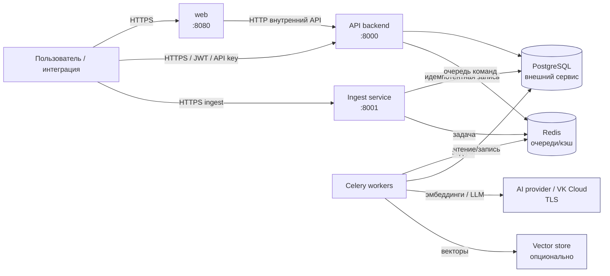

# Архитектура SAMoparser (проектный scaffold)

> **Статус документа:** проектное описание и границы будущей реализации. Описанные сервисы, API, таблицы и меры защиты **не считаются реализованными**. Документ не является утверждением о текущем состоянии репозитория.

## 1. Назначение и границы

SAMoparser должен принимать документы и записи, нормализовать их, извлекать признаки, сопоставлять с сущностями предметной области и предоставлять результаты через API и web-интерфейс. На первом этапе это только архитектурный scaffold: бизнес-правила, модели ML, миграции, обработчики и UI требуют отдельной реализации.

Вне границ scaffold:

- гарантии качества или полноты AI-сопоставления;
- автоматическое выполнение SQL, сгенерированного моделью;
- автоматическое изменение исходных данных без аудита и подтверждения;
- публикация или выбор конкретной лицензии без юридической проверки.

## 2. Контейнеры и взаимодействия



### Компоненты и границы ответственности

| Компонент | Порт / среда | Ответственность | Не должен делать |
|---|---:|---|---|
| `web` | `:8080` | UI, управление сессией, вызов публичного API | напрямую ходить в БД или AI-провайдера |
| `backend` | `:8000` | аутентификация, авторизация, CRUD, поиск, аудит, выдача результатов | принимать неограниченный файл или исполнять произвольный SQL |
| `ingest` | `:8001` | загрузка, проверка формата, вычисление fingerprint, регистрация источника, постановка задач | самостоятельно принимать решения о сопоставлении |
| Celery workers | внутренний | асинхронный parsing, enrichment, matching, индексация | обходить политики доступа и аудита |
| Redis | внешний managed-сервис в Kubernetes | брокер Celery и ограниченный кэш | хранить единственный источник истины |
| PostgreSQL | внешний managed-сервис в Kubernetes | транзакционные данные, аудит, статусы пайплайна | принимать запросы из web или внешнего пользователя напрямую |
| Vector store | опционально | поиск по embeddings | быть единственным хранилищем исходных данных |
| AI provider / VK Cloud | внешний | embeddings и/или классификация по согласованным контрактам | получать секреты, лишние PII или трафик без TLS |

В Kubernetes PostgreSQL и Redis предполагаются внешними сервисами с TLS, сетевыми ACL и отдельными секретами. Вариант локальных контейнеров допустим только для разработки и тестов.

## 3. Данные и модель БД

Рекомендуется PostgreSQL с UUID-идентификаторами, UTC timestamps, явными статусами и soft-delete там, где нужен аудит. Схема является целевой; миграции пока не заявлены как существующие.

### Основные сущности

- **`tenants`** — изоляция организаций/пространств: `id`, `name`, `status`, `created_at`.
- **`users`** — пользователь, хэш пароля/внешний subject, `tenant_id`, `role`, `status`.
- **`api_keys`** — интеграционные ключи: `id`, `tenant_id`, `key_prefix`, `secret_hash`, scopes, `expires_at`, `revoked_at`, `last_used_at`. Секрет после выдачи не хранится в открытом виде.
- **`sources`** — логический источник данных: тип, внешний идентификатор, конфигурация без секретов, владелец.
- **`ingest_batches`** — попытка загрузки: `source_id`, `idempotency_key`, content fingerprint, размер, статус, принятые/отклонённые записи, `created_at`; уникальность `(tenant_id, source_id, idempotency_key)` и/или fingerprint по согласованному режиму.
- **`documents`** — исходный объект и метаданные: `tenant_id`, `source_id`, storage reference, MIME, checksum, version, retention deadline.
- **`document_chunks`** — нормализованные фрагменты: `document_id`, порядковый номер, текст/маска PII, parser version, checksum.
- **`entities`** — канонические сущности предметной области: тип, нормализованное имя, атрибуты, состояние, версия.
- **`candidates`** — результат сопоставления: document/chunk, entity, score, method, model/version, decision status (`suggested`, `accepted`, `rejected`, `needs_review`).
- **`embeddings`** — vector reference или массив, model/version, dimension, source checksum; уникальность по `(chunk_id, model_version)`.
- **`jobs`** — идемпотентная задача пайплайна: тип, ключ идемпотентности, статус, попытки, ошибка без секретов, timestamps.
- **`audit_events`** — кто, когда и что сделал: actor, tenant, action, object reference, outcome, correlation id, минимальный diff; append-only политика.

Связи и ограничения: все tenant-owned записи обязаны иметь `tenant_id`; внешние ключи и индексы должны препятствовать «висячим» результатам; уникальные индексы должны быть согласованы с правилами повторной загрузки. Полнотекстовые и vector-индексы добавляются отдельными миграциями после измерений.

## 4. API-контракты (целевая версия `v1`)

Контракты ниже — предложение для реализации, не перечень уже доступных endpoint’ов. Все ответы должны содержать `request_id`; ошибки — стабильный `code`, безопасное `message` и необязательные `details` без секретов.

### Аутентификация и служебные endpoints

- `POST /v1/auth/token` — обмен учётных данных/внешнего authorization code на короткоживущий JWT.
- `POST /v1/api-keys` — создать ключ с scopes и TTL; plaintext возвращается только один раз.
- `DELETE /v1/api-keys/{id}` — отозвать ключ.
- `GET /health/live` — liveness без обращения к БД.
- `GET /health/ready` — readiness с проверкой обязательных зависимостей и таймаутом.

### Ingest (`:8001`)

- `POST /v1/ingest/batches` — multipart или ссылочный upload. Заголовки: `Authorization`, `Idempotency-Key`, `X-Correlation-ID`; ответ `202` с `{batch_id, status, accepted_count}`.
- `GET /v1/ingest/batches/{batch_id}` — статус и агрегаты, доступные только владельцу tenant.
- `POST /v1/ingest/batches/{batch_id}/retry` — повторить только безопасные failed jobs с проверкой полномочий.

### Backend API (`:8000`)

- `GET /v1/documents?cursor=&limit=` — пагинация с ограничением `limit`.
- `GET /v1/documents/{id}` — метаданные и статус обработки, без необязательного исходного PII по умолчанию.
- `GET /v1/candidates?status=&document_id=` — результаты и score, с фильтрами tenant.
- `POST /v1/candidates/{id}/decision` — принять/отклонить/отправить на review; обязательный audit event.
- `POST /v1/query/preview` — безопасный preview структурированного запроса или результата; не выполняет модельный SQL напрямую.

Коды: `201` для созданного ресурса, `202` для асинхронной операции, `400/422` для валидации, `401/403` для authz, `404` без раскрытия существования чужого объекта, `409` для конфликтующей идемпотентности, `429` для rate limit, `503` при недоступной зависимости.

## 5. JWT, API keys и секреты

- JWT подписывается асимметричным ключом (например, RS256/ES256), имеет короткий TTL, `iss`, `aud`, `sub`, `iat`, `exp`, `jti`; алгоритм фиксируется конфигурацией, а не принимается из token header.
- Authorization middleware проверяет tenant, scopes, роль, отзыв и срок действия. JWT не является источником полномочий сам по себе.
- API key передаётся по TLS, хранится только как hash с salt; в логах — только prefix и fingerprint. Ротация, отзыв, TTL и минимальные scopes обязательны.
- Секреты подаются через secret manager/Kubernetes Secret, не в образе, git, миграциях или telemetry. Логи и трассировки проходят redaction.
- TLS обязателен на внешних соединениях; для VK Cloud явно проверяется сертификатная цепочка и hostname, запрещается отключение `verify`. Для внутренних Kubernetes-соединений — TLS по политике кластера, предпочтительно mTLS.

## 6. Идемпотентный ingest и обработка

1. Клиент передаёт `Idempotency-Key`; сервис валидирует размер, tenant scope и TTL ключа.
2. В транзакции создаётся `ingest_batch` с уникальным ключом. Повтор того же запроса возвращает первоначальный результат, а другой payload с тем же ключом — `409`.
3. Для каждого документа вычисляется криптографический checksum; повторный файл может быть связан с существующей версией по явно заданной политике.
4. В очередь публикуется задача с детерминированным `job_key = tenant/source/document/version/stage` после commit (outbox pattern или эквивалент).
5. Worker использует upsert/unique constraints, lease/visibility timeout и безопасный retry. Побочные эффекты выполняются после проверки статуса и версии.
6. Частичный сбой фиксируется в `jobs` и batch status; retry не дублирует документы, candidates или embeddings.

## 7. AI matching pipeline

```text
ingest -> parse/normalize -> PII policy -> chunk -> embeddings
      -> candidate retrieval (vector + lexical) -> rerank/classify
      -> thresholding -> human review -> accepted/rejected + audit
```

Каждый этап версионируется (`parser_version`, `embedding_model`, `matching_policy`) и сохраняет входной checksum. Низкий score, конфликт моделей, новые типы сущностей и подозрительные данные переходят в `needs_review`; AI не получает права самовольно менять канонические сущности.

Стратегия vector search:

1. основной путь — согласованный vector store или PostgreSQL extension;
2. fallback — лексический поиск и детерминированные признаки (нормализация, exact/phonetic keys, trigram/full-text), с явной маркировкой `method=lexical_fallback`;
3. если embedding provider недоступен, job остаётся retryable, а безопасный fallback не маскирует degraded status;
4. размерность, модель, язык, нормализация и порог similarity фиксируются в конфигурации версии.

Перед отправкой в VK Cloud выполняются минимизация данных, маскирование PII, timeout, retry budget и запрет отправки непредусмотренных полей. Весь трафик — TLS с проверкой сертификата.

## 8. Безопасный text-to-SQL: защита на уровне БД

Text-to-SQL рассматривается только как генератор намерения/структуры, но не как доверенный исполнитель.

**Предпочтительный контракт:** модель возвращает JSON AST или имя заранее определённого отчёта с параметрами. Backend валидирует схему, allowlist таблиц/полей/операций, типы и лимиты, после чего строит parameterized SQL сам.

Если SQL принимается на переходном этапе, обязательны:

- отдельная read-only роль БД без `INSERT/UPDATE/DELETE/DDL`, доступа к системным таблицам и секретам;
- отдельная схема/view allowlist с минимально необходимыми колонками; не выдавать модели прямой доступ к таблицам;
- PostgreSQL Row Level Security по `tenant_id`, установка tenant context из проверенного server-side claim; запрет клиенту самостоятельно задавать context;
- `statement_timeout`, `lock_timeout`, лимит строк, лимит времени и размер результата на роли/сессии;
- запрет multiple statements, комментариев, `COPY`, функций с побочными эффектами, `dblink`, внешних таблиц и unsafe extensions;
- параметризация значений, AST parsing и статический анализ перед выполнением; dry-run/EXPLAIN без выполнения пользовательских функций;
- отдельный connection pool и аудит prompt, нормализованного запроса, результата policy check и actor; секреты и полный PII не писать в audit;
- при нарушении политики — отказ, а не попытка «починить» SQL молча.

Это defense-in-depth: фильтр приложения не заменяет права и RLS в PostgreSQL.

## 9. Развёртывание и миграции

Для Kubernetes целевая схема включает отдельные Deployment для `backend`, `ingest`, `web`, worker и beat (если нужен scheduler), Service/Ingress, NetworkPolicy, Secret/ConfigMap и HPA после измерений. PostgreSQL и Redis подключаются как внешние managed endpoints.

**Migration hook сейчас отключён, поскольку реализация миграций отсутствует.** Нельзя объявлять автоматическое применение схемы готовым. После появления миграций нужен отдельный одноразовый Job/релизный шаг с lock, backup/rollback-планом, проверкой совместимости схемы и smoke test; миграции не должны запускаться каждым pod при старте.

## 10. Лицензия и политика рисков

- До выбора лицензии провести инвентаризацию зависимостей, моделей, датасетов, prompt’ов и внешних API; отдельно проверить copyleft/notice/model terms и ограничения VK Cloud.
- Не смешивать код, данные клиентов и модели с несовместимыми условиями распространения. В репозитории должны появиться LICENSE, NOTICE и SBOM только после юридического решения.
- Риск-регистр минимум: утечка PII, cross-tenant доступ, prompt injection, SQL injection/text-to-SQL, недетерминированный matching, provider outage, supply-chain CVE, потеря очереди, некорректная миграция и нарушение retention.
- Для каждого риска назначить владельца, вероятность/влияние, контроль, метрику, residual risk и процедуру инцидента. AI-результат маркировать как рекомендацию до подтверждения человеком.
